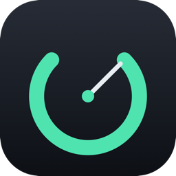

# OpenCode Usage



A macOS menu bar app that shows what your OpenCode **Go** plan is using, right
now. Port of the Noctalia plugin from my dotfiles.

The menu bar shows the gauge and three figures — `H 2% W 13% M 10%` — where
**H** is the last 5 hours, **W** the current week (Monday start) and
**M** the calendar month. H is a rolling sum, not the console's resetting
5-hour meter, so it can disagree with the console right after a reset. Any
combination can be turned off in settings. Click for per-model spend, requests
and tokens.

## Requirements

- macOS 14 or newer.
- opencode installed (`brew install sst/tap/opencode`) and signed in to a Go
  plan. The app asks the CLI for the credential with `opencode auth export` and
  keeps nothing of its own: no key is stored, there is no login screen, and if
  the key is missing or expired the panel points at `opencode auth login`.

## Install

```shell
brew tap Myleshen/tap
brew install --cask opencode-usage
```

The cask lives in [Myleshen/homebrew-tap](https://github.com/Myleshen/homebrew-tap)
(alongside my other casks). `brew upgrade` picks up new releases from there.

Or download `OpenCodeUsage.zip` from the latest release and drag the app out.

### Ad-hoc signing (first launch)

The build is signed ad-hoc, not notarised, so a copy that came through a
browser carries a quarantine flag and Gatekeeper will call it *damaged*. The
cask clears the flag in a `postflight` step, so a Homebrew install just works.
For a manual download, clear it yourself once:

```shell
xattr -dr com.apple.quarantine /Applications/OpenCodeUsage.app
```

or right-click the app → **Open** → **Open** to approve it. Nothing is
downloaded again at runtime; the only network traffic is the usage API.

## Build

```shell
./build.sh                      # this machine's arch
ARCHS="arm64 x86_64" ./build.sh # universal
open build/OpenCodeUsage.app
```

No Xcode project, no packages: `build.sh` runs one `swiftc` call and assembles
the bundle. The icon lives in `Resources/AppIcon.icns`; `./icon.sh` redraws it
from `Resources/icon.swift`.

Self-checks:

```shell
./build/OpenCodeUsage.app/Contents/MacOS/OpenCodeUsage --selftest   # offline asserts
./build/OpenCodeUsage.app/Contents/MacOS/OpenCodeUsage --dump       # live fetch, prints numbers
./build/OpenCodeUsage.app/Contents/MacOS/OpenCodeUsage --limits     # ask opencode's own usage route
./build/OpenCodeUsage.app/Contents/MacOS/OpenCodeUsage --loginitem on|off  # same as the settings toggle
```

## Settings

Open the panel, click the gear.

| Setting | Default | Notes |
| --- | --- | --- |
| Refresh | 10 min | Timer keeps running while the panel is closed. |
| Org ID | empty | Only for keys that can reach several workspaces: the header is sent only when set. |
| Warn / critical | 80% / 95% | Panel color and warning triangle. |
| Menu bar | H + W + M | Which figures to show. |
| Launch at login | off | Writes and registers `~/Library/LaunchAgents/dev.myleshen.opencode-usage.plist`. |

### One scope only

The console attributes each request to a principal, and API-key traffic is
billed to a *service account*, not to your member id. On my workspace the
member account had $0.85 this month while the account total was $10 — same Go
quota, so filtering to the member id would have under-reported it by an order of
magnitude. The app therefore always shows every principal the key can see.

Only the `go` plan table is included. On another plan (or a model added after
this build) there is no limit to compare against, so the panel shows
"no limit data" and a banner, while spend and request counts keep updating.
Adding `go_plus` / `go_teams` limits to `Sources/Usage.swift` would fix that.

## How it works

1. Asks the CLI for the active Go credential (`opencode auth export`) rather
   than reading opencode's sqlite file, so a schema change cannot break it. The
   key never leaves the machine except as the `Authorization` header to
   `opencode.ai`.
2. `GET /console/api/usage/models?since=…` for the 5h / week / month / today
   windows, in parallel, following pagination.
3. Filters `provider == "opencode-go"`, converts `totalCostMicroCents / 1e8` to
   USD, and compares against the plan limits (5h cap = 20% of the limit, week
   50%, month 100%).

Window boundaries use the local calendar (Monday start), converted to UTC ISO
for the `since` parameter — `since` must be a `Z` timestamp: the API rejects
`+05:30`, `+00:00` and zone-less values. Durations are zone-independent, so the
5h cutoff is an exact instant; only the week/month/today boundaries depend on
this Mac's timezone.

## Notes

- The launch-at-login plist records the absolute path of the bundle. If the app
  is moved or rebuilt elsewhere, the next launch rewrites the plist to the path
  it is running from, so the login item keeps working.
- Launching the app twice is safe: the newer copy exits and the older one keeps
  the menu bar item, so the login item cannot produce a duplicate.
- No Quit menu item — `pkill -f OpenCodeUsage` or delete the app.
- Uninstall: `brew uninstall --cask opencode-usage` (it also removes the
  LaunchAgent and quits the app). `brew uninstall --zap` also drops the lock
  file.

## Releasing

`.github/workflows/release.yml` builds a universal app, runs the self-test, zips
it and publishes `OpenCodeUsage.zip` on a `v*` tag. The cask installs from
`releases/latest/download/OpenCodeUsage.zip`, so a new tag is enough for
`brew upgrade`.
